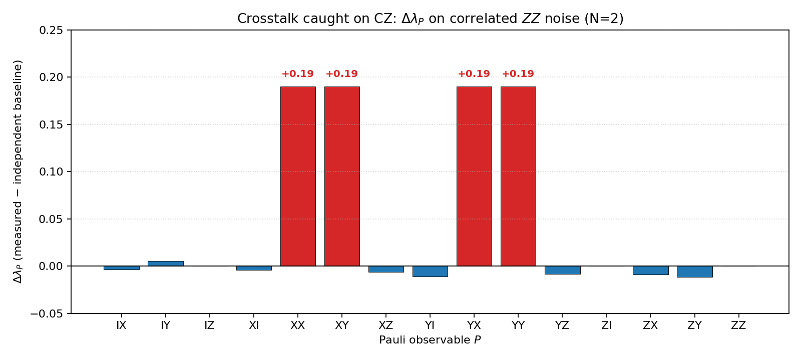
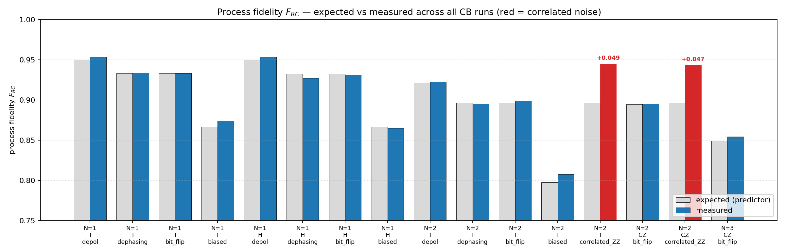
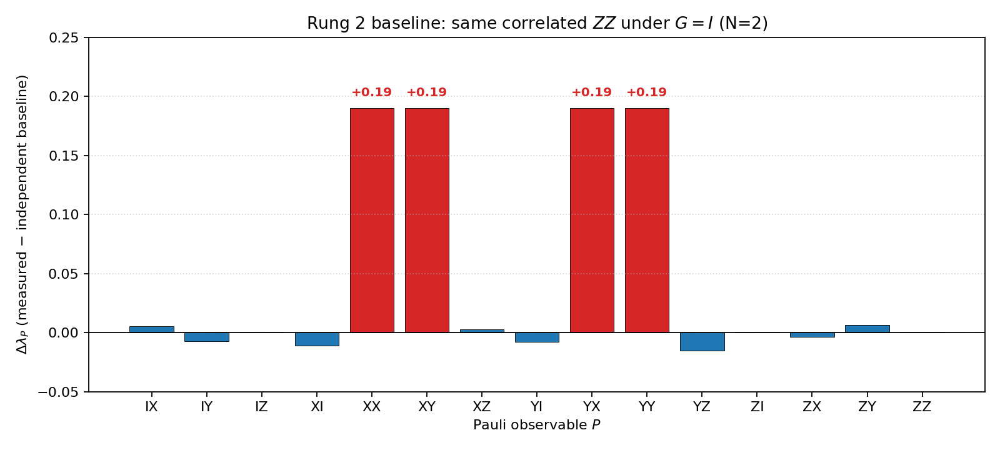
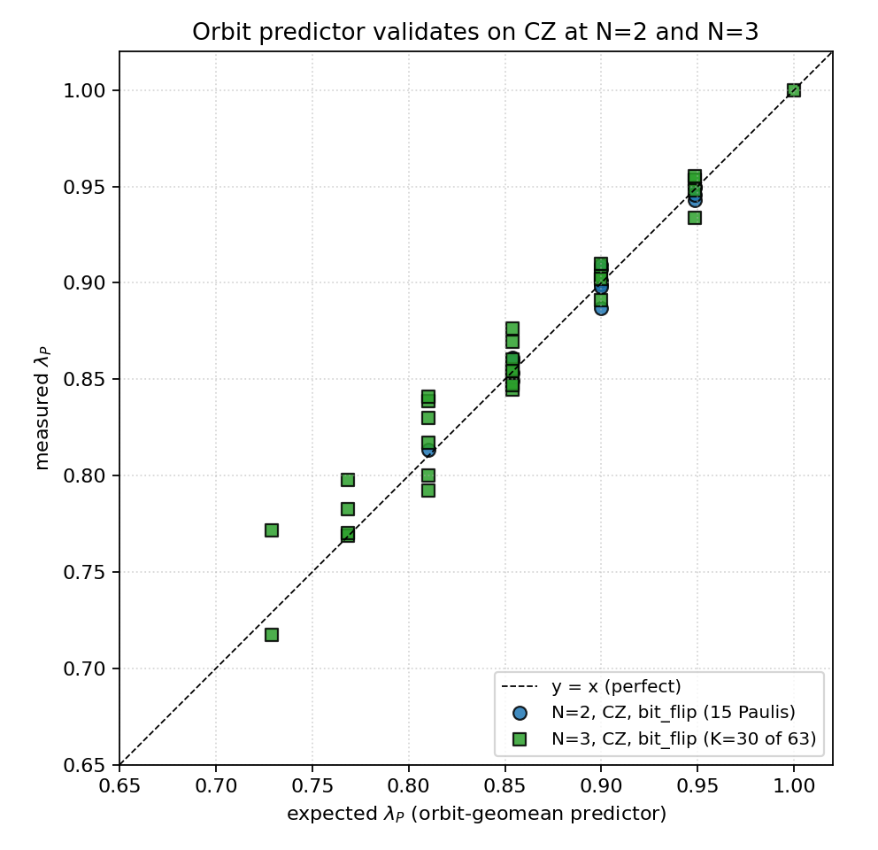

> **Project:** Cycle Benchmarking
> **Notebook:** [`CB.ipynb`](../CB/CB.ipynb) · **Spec:** [`CB_plan.md`](../CB/CB_plan.md)
> **Scope:** N=1, 2, 3 — 7 experiments
> **Next:** N=10 stabilizer-sim demo, IBM hardware run
> **Reader:** assumes the Randomized Benchmarking slides (meetings 1–3) for theory. This report is what was built and what it showed.

---

## 1 · TL;DR

CB was built end-to-end in Qiskit and validated on 1, 2, and 3 qubits across **seven
experiments**. The pipeline produces the per-Pauli fidelities $\lambda_P$
within shot noise for every channel — and, the headline result, **catches a real
two-qubit crosstalk error on a real entangling gate (CZ)**: under correlated `ZZ`
noise, the measured $\lambda_P$ for `{XX, XY, YX, YY}` jumps from the independent-noise
baseline `0.81` to `1.00` (Δ = **+0.19**), while the other 11 Paulis stay flat.
That four-Pauli cluster is the signature that SRB averages away.

## 2 · Headline figure



$\Delta\lambda_P = \lambda_P^{\text{measured}} - \lambda_P^{\text{(independent baseline)}}$. Four Paulis spike to $+0.19$;
the rest sit at the shot-noise floor. **That cluster is the crosstalk fingerprint.**

## 3 · The seven experiments

| Experiment | Setup | What it shows | $F_{RC}$ (expected $\rightarrow$ measured) |
|---|---|---|---|
| 1 | N=1, G=I, 4 indep noises | per-Pauli $\lambda_P$; commute formula on a flat cycle | 0.87–0.95 → 0.87–0.95 |
| 2 | N=1, G=H, 4 indep noises | H rotates `X↔Z` → preview of orbit-geomean | 0.87–0.95 → 0.86–0.95 |
| 3 | N=2, G=I, 4 indep noises | factorization `λ_{A⊗B} = λ_A·λ_B` holds | 0.80–0.92 → 0.81–0.92 |
| 4 | N=2, G=I, **correlated `ZZ`** | factorization **breaks** on `{XX,XY,YX,YY}` | 0.896 → **0.945** ⚡ |
| 5 | N=2, G=**CZ**, bit_flip | orbit-geomean predictor on a real entangler | 0.895 → 0.895 |
| 6 | N=2, G=CZ, **correlated `ZZ`** | crosstalk caught *on the gate* — the payoff | 0.896 → **0.943** ⚡ |
| 7 | **N=3**, G=CZ, bit_flip | scaling: K-subset, 3q orbits, noise tensoring | 0.849 → 0.854 |



The two **red** bars are the correlated-noise runs (Exp 4 and Exp 6).
Measured $F_{RC}$ sits ~5% *above* the predicted baseline — averaging over Paulis
hides the +0.19 spike. **The per-Pauli $\lambda_P$ view is what tells the truth.**

---

## 4 · Methods

Slides cover the CB protocol (Meeting 3, slides 39–48). Recap of the bits this
report uses, in slide notation.

### 4.1 · Notation recap

| Object | Form | What it is |
|---|---|---|
| Ideal map / noisy map | $G : \rho \mapsto G\rho G^\dagger$ / $\hat G = \Lambda \circ G$ | ideal vs hardware |
| Ideal circuit | $C(P) = G^m(P) = \varepsilon P$ | classical answer key (since $G^m = I$) |
| Noisy circuit | $\hat C(\rho) = R_m \circ \hat G \circ \ldots \circ R_1 \circ \hat G \circ R_0(\rho)$ | run on Aer |
| Single-run overlap | $f_{P,m,l} = \mathrm{Tr}[C(P) \cdot \hat C(\rho)]$ | $=+1$ if noiseless |
| Sequence average | $F_{P,m} = (1/L) \cdot \sum_l f_{P,m,l}$ | over $L$ random Pauli draws |
| Twirled noise (per direction) | $\Lambda_T(P) = \lambda_P \cdot P$ | the diagonal Pauli channel CB measures |
| Two-length ratio (SPAM-free) | $\lambda_P = \left(F_{P,m_2}/F_{P,m_1}\right)^{1/(m_2-m_1)}$ | $\alpha$ cancels |
| Process fidelity | $F_{RC} = (1/K) \cdot \sum_P \lambda_P$ | one number from K Paulis |
| Error per cycle | $r_{RC} = 1 - F_{RC}$ | headline error |

### 4.2 · Knobs

| Knob | Setting | Why |
|---|---|---|
| `G` | I, H, CZ (disjoint-pair layer) | I = flat baseline; H, CZ = non-Pauli Cliffords, they rotate `P` |
| $m_1, m_2$ | 4, 8 (N≥2); 4, 12 (N=1) | both multiples of cycle order ⇒ $G^m = I$ |
| $K$ | all $4^N - 1$ for N≤2; random 30 of 63 for N=3 | full coverage where it fits |
| $L$ | 30 per `(P, m)` | shot-noise vs runtime |
| `shots` | 100 (N=1), 200 (N≥2) | shot floor matters as $\lambda_P \to 0$ |
| sim backend | Aer; noise on a labelled `UnitaryGate("CB_Cycle")` | clean noise injection (IRB trick) |

### 4.3 · How CB resolves one number per Pauli direction

The Pauli twirl over the random $R_i$ forces the noise on $\hat G$ to a *diagonal*
Pauli channel: $\Lambda_T(P) = \lambda_P \cdot P$ — each direction decays independently with
its own scalar $\lambda_P$ (slide 46–47). One dressed cycle pulls one factor of
$\lambda_P$ for the running observable; $m$ cycles stack to $\lambda_P^m$, giving
$F_{P,m} = \alpha \cdot \lambda_P^m$ (slide 48). The two-length ratio cancels $\alpha$ and leaves
$\lambda_P$ per direction.

### 4.4 · How we predict $\lambda_P$ (for sim validation)

The **commute formula** is the closed-form expression that maps a Pauli noise channel `{p_Q}` to the per-direction decay $\lambda_P$. It asks: which error operators $Q$ commute with the observable $P$? Those leave its sign alone ($+1$); the rest flip it ($-1$):

$$\lambda_P^{\text{bare}} = \sum_Q p_Q \cdot \big(+1 \text{ if } [Q,P]=0 \text{ else } -1\big).$$

Each error $Q$ that anticommutes with $P$ flips the observable's sign, contributing
$-1$. When $G$ rotates $P$ between cycles (H, CZ), the noise on each successive cycle
hits the *rotated* observable, not the original. So what you measure is not bare
$\lambda_P$ but a **geometric mean over $P$'s orbit** of the bare $\lambda$'s. Full
derivation in Exp 5.

### 4.5 · Two detectors, two jobs

| Detector | What it does (in one line) | Where used |
|---|---|---|
| **orbit-geomean predictor** | Given the *injected* noise, predicts what $\lambda_P$ *should* be. Compare to measured: a gap = bug (or crosstalk). | simulator (we know the noise) |
| **`factorization_test`** | Checks whether the joint $\lambda_{A \otimes B}$ equals the product of single-qubit $\lambda$'s. No noise info needed. | hardware (works on identity cycle; needs orbit-aware fix for CZ — open under #6) |

In sim the orbit predictor is the honest yardstick. Factorization will become the
hardware self-consistency check once an orbit-aware fix lands for rotating gates
(open for #6).

---

## 5 · Experiments

Each section: **setup → C(P) and Ĉ(ρ) → how noise determines $\lambda_{P}$ → results →
walk one critical Pauli → verdict**. Numbers are pulled verbatim from the
notebook outputs.

### Exp 1 — N=1, G=I, independent noise

**Setup.** $N = 1$, $K = 3$ (X, Y, Z), `G=I`, $m_1 = 4$, $m_2 = 12$, `shots=100`, `L=30`.
Four noise channels:
`depolarizing(p=0.05)` · `dephasing{I:0.95, Z:0.05}` · `bit_flip{I:0.95, X:0.05}` ·
`biased{I:0.90, X:0.03, Y:0.02, Z:0.05}`.

**$C(P) = I^4(P) = P$** ($G=I$, $\varepsilon=+1$; same form at $m_1=4$ and $m_2=12$).
**$\hat C(\rho)$ at $m_1 = 4$** — Ĝ = Λ (since G=I); five 1-qubit random Paulis
$R_i \in \{I, X, Y, Z\}$, four Λ insertions:
$$\hat C(\rho) = R_4 \circ \Lambda \circ R_3 \circ \Lambda \circ R_2 \circ \Lambda \circ R_1 \circ \Lambda \circ R_0(\rho).$$
After the twirl each Λ acts as $\Lambda_T$ on the running observable, pulling out
one factor of $\lambda_P$ per cycle → $F_{P,4} = \alpha \cdot \lambda_P^4$.

**The split into individual Paulis happens before the math — at protocol design.**
A single pass of the protocol = one chosen P. Concretely:

1. Pick one P up front (say P=X for this pass).
2. Prepare the +1 eigenstate of that P as the input ρ. For P=X, ρ = $|+\rangle\langle+|$;
   for P=Z, ρ = $|0\rangle\langle 0|$; etc.
3. Run the dressed circuit Ĉ(ρ) (the chain `R_4 ∘ Λ ∘ R_3 ∘ Λ ∘ ...` written
   above).
4. Measure ⟨P⟩ at the end — just the one P you started with. That gives a
   single number $f_{P,m,l}$.
5. Average over L sequences → $F_{P,m}$. Run at m₁=4 and m₂=12 → ratio →
   $\lambda_P$ for that one direction.

So $F_{P,4} = \alpha \cdot \lambda_P^4$ is *per pass* — it's $F_{X,4} = \alpha \cdot \lambda_X^4$ for the X
pass, $F_{Y,4} = \alpha \cdot \lambda_Y^4$ for the Y pass, etc. They're literally three
independent experiments. Three preps, three measurements, three two-length
ratios → three rows in [Exp 1's table](#exp1-results). (Same K-passes-K-rows logic holds for
Exp 2–7; K just grows.)

**Noise $\rightarrow \lambda_P$.** Commute formula directly. Predicted triples `(λ_X, λ_Y, λ_Z)`:

| Noise | predicted $(\lambda_X, \lambda_Y, \lambda_Z)$ |
|---|---|
| depol(p) | $(1-p,\ 1-p,\ 1-p)$ |
| dephasing(q) | $(1-2q,\ 1-2q,\ 1)$ |
| bit_flip(q) | $(1,\ 1-2q,\ 1-2q)$ |
| biased | $(p_I + p_X - p_Y - p_Z,\ p_I + p_Y - p_X - p_Z,\ p_I + p_Z - p_X - p_Y)$ |

[]{#exp1-results}
**Results.**

| Noise | $\lambda_X$ | $\lambda_Y$ | $\lambda_Z$ | $F_{RC}$ (exp $\rightarrow$ meas) |
|---|---|---|---|---|
| depolarizing | 0.9500 → 0.9534 | 0.9500 → 0.9516 | 0.9500 → 0.9552 | 0.9500 → 0.9534 |
| dephasing | 0.9000 → 0.8985 | 0.9000 → 0.9026 | **1.0000 → 1.0000** | 0.9333 → 0.9337 |
| bit_flip | **1.0000 → 1.0000** | 0.9000 → 0.9052 | 0.9000 → 0.8950 | 0.9333 → 0.9334 |
| biased | 0.8600 → 0.8802 | 0.8400 → 0.8366 | 0.9000 → 0.9054 | 0.8667 → 0.8740 |

**Walking the critical Paulis — dephasing.** Channel = `{I:0.95, Z:0.05}`.
- $\lambda_Z$: `Z` error commutes with the `Z` observable $\rightarrow$ no sign flip ever $\rightarrow$ $\lambda_Z = p_I + p_Z = 1.00$. **Measured 1.0000 exactly** (the protected axis).
- $\lambda_X$: `Z` anticommutes with `X` $\rightarrow$ sign flips when the error fires $\rightarrow$ $\lambda_X = p_I - p_Z = 1 - 2q = 0.90$. Measured 0.8985 (within shot noise).

**Verdict.** Pipeline is correct on 1 qubit. *Anisotropy* — i.e. $\lambda_P$
varying across directions $X, Y, Z$ — is visible: dephasing protects $Z$,
bit_flip protects $X$, biased protects nothing. All $|\Delta| \leq 0.02$.

### Exp 2 — N=1, G=H, independent noise

**Setup.** Same as Exp 1 but `G=H` (Hadamard, order 2). $m_1 = 4$, $m_2 = 12$ both even.

**$C(P) = H^4(P) = P$** ($H^2 = I \Rightarrow H^4 = I$; $\varepsilon = +1$).
**$\hat C(\rho)$ at $m_1 = 4$** — Ĝ = Λ∘H; same five 1q random Paulis as Exp 1:
$$\hat C(\rho) = R_4 \circ \Lambda \circ H \circ R_3 \circ \Lambda \circ H \circ R_2 \circ \Lambda \circ H \circ R_1 \circ \Lambda \circ H \circ R_0(\rho).$$
Between cycles the H factor rotates the running observable: `X ↔ Z`.

**What's different.** `H` is a **non-Pauli Clifford**. Between cycles, `H` rotates
the observable: `H X H = Z` and `H Z H = X` (and `H Y H = −Y`). So a cycle on
`X` looks like noise on `X`, then on `Z`, then on `X`, … alternating. The
recovered $\lambda_X$ mixes the bare $\lambda_X$ and bare $\lambda_Z$.

**Noise $\rightarrow \lambda_P$.** The commute formula (Methods §4.4) still
gives the *raw* per-direction values $\lambda_X^{\text{bare}}, \lambda_Z^{\text{bare}}$.
Here *bare* means the $\lambda$ you'd see without the H rotation — i.e. on the
flat identity cycle of Exp 1. The cycle's *recovered* $\lambda_X$ is the geometric
mean over the orbit $\{X, Z\}$ — i.e. $\lambda_X^{\text{recovered}} = \sqrt{\lambda_X^{\text{bare}} \cdot \lambda_Z^{\text{bare}}}$.
(Full derivation in Exp 5.)

[]{#exp2-results}
**Results.**

| Noise | $\lambda_X$ | $\lambda_Y$ | $\lambda_Z$ | $F_{RC}$ (exp $\rightarrow$ meas) |
|---|---|---|---|---|
| depolarizing | 0.9500 → 0.9488 | 0.9500 → 0.9563 | 0.9500 → 0.9561 | 0.9500 → 0.9537 |
| dephasing | 0.9487 → 0.9483 | 0.9000 → 0.8861 | 0.9487 → 0.9473 | 0.9325 → 0.9272 |
| bit_flip | 0.9487 → 0.9463 | 0.9000 → 0.8965 | 0.9487 → 0.9501 | 0.9325 → 0.9310 |
| biased | 0.8798 → 0.8830 | 0.8400 → 0.8415 | 0.8798 → 0.8702 | 0.8665 → 0.8649 |

**Walking the critical Pauli — dephasing on X.** Bare: `λ_X^bare = 0.90`,
`λ_Z^bare = 1.00`. Through H, X rotates to Z and back. Orbit `{X, Z}`.
Predicted `λ_X^recovered = √(0.90 · 1.00) = 0.9487`. **Measured 0.9483.** The
protected `Z` axis is shared with X across the orbit — there is no axis the H
cycle leaves fully protected.

**Verdict.** Non-Pauli Clifford handled correctly. The "protected axis"
behaviour we saw in Exp 1 partly collapses to the orbit geomean — exactly the
machinery CZ will need at N=2.

### Exp 3 — N=2, G=I, independent noise

**Setup.** $N = 2$, $K = 15$ (all non-identity 2q Paulis), `G=I`, $m_1 = 4$, $m_2 = 8$,
`shots=200`, `L=30`. Same four noise channels, each **tensored** to 2 qubits
(error fires independently on each qubit).

**$C(P) = I^4(P) = P$**, $\varepsilon = +1$.
**$\hat C(\rho)$ at $m_1 = 4$** — same chain shape as Exp 1; $R_i$ now 2-qubit Paulis (16
options each) and $\Lambda$ is the tensored 2q channel:
$$\hat C(\rho) = R_4 \circ \Lambda \circ R_3 \circ \Lambda \circ R_2 \circ \Lambda \circ R_1 \circ \Lambda \circ R_0(\rho).$$

*Concrete example* (bit_flip): $\Lambda$ is the explicit 2q Pauli channel
$\{II: 0.9025,\ IX: 0.0475,\ XI: 0.0475,\ XX: 0.0025\}$ — each row a 2q Pauli
error with the product of per-qubit probabilities. A 2q random Pauli $R_i$ is
drawn uniformly from $\{II, IX, IY, IZ, XI, XX, \ldots, ZZ\}$ — 16 options.

**Noise $\rightarrow \lambda_P$.** Independent per-qubit noise $\Rightarrow$ joint $\lambda_{A \otimes B}$ should
**factorize**:

$$\text{Predicted: } \quad \lambda_{A \otimes B} = \lambda_A \cdot \lambda_B.$$

This factorization is the per-qubit commute formula applied to each qubit
separately, then multiplied — independent noise can't couple the two.

[]{#exp3-results}
**Results ($F_{RC}$ summary, all 4 noises).**

| Noise | $F_{RC}$ expected | $F_{RC}$ measured | $\Delta$ |
|---|---|---|---|
| depolarizing | 0.9215 | 0.9226 | +0.0011 |
| dephasing | 0.8960 | 0.8949 | −0.0011 |
| bit_flip | 0.8960 | 0.8986 | +0.0026 |
| biased | 0.7973 | 0.8075 | +0.0102 |

**Walking the critical Pauli — dephasing on $XX$.** Per-qubit dephasing has
$\lambda_X = 0.90$ and $\lambda_Z = 1.0$ (from Exp 1). Tensored:
- $\lambda_{XX} = \lambda_X \cdot \lambda_X = 0.81$. Measured $0.8058$. $\checkmark$
- $\lambda_{XZ} = \lambda_X \cdot \lambda_Z = 0.90 \cdot 1.0 = 0.90$. Measured $0.9006$. $\checkmark$
- $\lambda_{ZZ} = \lambda_Z \cdot \lambda_Z = 1.0$. Measured $1.0000$. $\checkmark$

All 15 Paulis under all 4 channels match the factorization prediction within
shot noise. (Worst single Δ across the 60 predictions: `+0.068` on `YX` under
biased noise — still within the shot floor at 200 shots × 30 draws.)

**Verdict.** N-qubit pipeline is sound. The $F_{RC}$ drop vs Exp 1 is pure
independent-error accumulation (weight-2 Paulis decay as a product), nothing
mysterious.

### Exp 4 — N=2, G=I, correlated `ZZ` noise

**Setup.** Same as Exp 3, but a new noise channel: a single 2-qubit Pauli error,
`{II:0.95, ZZ:0.05}`. Both qubits get hit by `Z` *together* or not at all — it is
**not** a tensor of two 1-qubit channels.

**$C(P) = P$**, $\varepsilon = +1$.
**$\hat C(\rho)$ at $m_1 = 4$** — same chain as Exp 3, but $\Lambda$ is now the **single 2-qubit**
Pauli error $\{II: 0.95,\ ZZ: 0.05\}$ (not a tensor of two 1q channels):
$$\hat C(\rho) = R_4 \circ \Lambda \circ R_3 \circ \Lambda \circ R_2 \circ \Lambda \circ R_1 \circ \Lambda \circ R_0(\rho).$$

*Operator-form sanity check.* This $\Lambda$ has only two operators: identity
($II$, fires 95% of the time) and $Z \otimes Z$ (fires 5%). When $ZZ$ fires,
both qubits feel the same $Z$ *simultaneously* — no way to factor it into two
independent per-qubit channels.

*No orbit-geomean here.* $G = I$, so every Pauli's orbit has length 1 — the
geomean step reduces to the bare $\lambda_P$. Orbit-geomean machinery only
kicks in once $G$ rotates Paulis (Exp 5 onward).

**Noise $\rightarrow \lambda_P$.** Same commute formula, now over 2-qubit errors. The independent
**baseline** comes from the marginal of this noise: each qubit *alone* sees
`{I:0.95, Z:0.05}` — i.e. dephasing-0.05 per qubit. So Exp 3's dephasing
prediction is what we compare against. The data on whether the noise is really
independent or not is in the **per-Pauli $\lambda_P$**.

[]{#exp4-results}
**Results.**

| Input | predicted (indep. baseline) | measured | $\Delta$ |
|---|---|---|---|
| IX, XI, IY, YI (single-X/Y marginals) | 0.9000 | 0.8890 – 0.9055 | ≈ 0 |
| IZ, ZI, ZZ (Z-immune) | 1.0000 | 1.0000 | 0 |
| XZ, ZX, YZ, ZY (one X/Y, one Z) | 0.9000 | 0.8847 – 0.9065 | ≈ 0 |
| **XX, XY, YX, YY** | **0.8100** | **1.0000** | **+0.1900** ⚡ |
| $F_{RC}$ | 0.8960 | **0.9447** | **+0.0487** |

**Walking the critical Pauli — XX.** Under correlated `{II:0.95, ZZ:0.05}`:

- The `ZZ` error fires (probability 0.05). It hits both qubits with a `Z`.
- The `XX` observable measures `X` on each qubit. `Z` anticommutes with `X`, so each side flips → sign flips on *both* qubits in the same shot → `(−1)(−1) = +1`.
- The $XX$ reading is $+1$ even when the error fires. Verdict: $\lambda_{XX} = 1.0$ exactly.

The independent prediction would have been $\lambda_X \cdot \lambda_X = 0.90 \cdot 0.90 = 0.81$. The
gap $+0.19$ is **the crosstalk fingerprint**: only correlated $Z$'s on both qubits
can cancel into $+1$ on $XX$. Independent dephasing cannot — two separate flips
are not synchronised. Same logic applies to $XY, YX, YY$ — both observables are
"flippable" by $Z$, both flips fire together $\rightarrow$ cancel $\rightarrow$ $\lambda = 1.0$.



**Verdict.** Under correlated $ZZ$, four Paulis decay slower than the independent
baseline by exactly $+0.19$, while the other eleven stay on baseline. $F_{RC}$
averages this up to $0.945$ — about $5\%$ above the matching independent noise
baseline of $0.896$. The headline $F_{RC}$ number looks *better* under crosstalk;
the per-Pauli $\lambda_P$ view catches the trick that $F_{RC}$ hides.

### Exp 5 — N=2, G=CZ, bit_flip — *and the orbit-geomean explainer*

**Setup.** $N = 2$, $K = 15$, `G=CZ` (order 2), $m_1 = 4$, $m_2 = 8$, `shots=200`, `L=30`,
`noise = bit_flip{I:0.95, X:0.05}` tensored.

**$C(P) = CZ^4(P) = P$** ($CZ^2 = I \Rightarrow CZ^4 = I$; $\varepsilon = +1$).
**$\hat C(\rho)$ at $m_1 = 4$** — Ĝ = Λ∘CZ; $R_i$ are 2q random Paulis; $\Lambda$ is bit_flip
tensored to 2 qubits:
$$\hat C(\rho) = R_4 \circ \Lambda \circ CZ \circ R_3 \circ \Lambda \circ CZ \circ R_2 \circ \Lambda \circ CZ \circ R_1 \circ \Lambda \circ CZ \circ R_0(\rho).$$
Between cycles the CZ factor rotates the running observable around its orbit
(see the rule below).

**What's new.** CZ is a non-Pauli Clifford — like H but on two qubits. It
**rotates Paulis** between cycles, on a specific pattern:

> **CZ rule:** `X` or `Y` on a qubit → drops a `Z` on the partner (and toggles `I↔Z`, `X↔Y` on it). `I` or `Z` on a qubit → frozen.

So CZ has **fixed Paulis** $\{ZI, IZ, ZZ\}$ (every qubit holds an $I$ or $Z$ — nothing to rotate), and **2-cycle orbits** for the rest: $\{XI \leftrightarrow XZ\}$, $\{IX \leftrightarrow ZX\}$, $\{YI \leftrightarrow YZ\}$, $\{IY \leftrightarrow ZY\}$, $\{XX \leftrightarrow YY\}$, $\{XY \leftrightarrow YX\}$.

*Worked example — one orbit step.* Start with the observable $XI$ ($X$ on q0, $I$ on q1). One CZ cycle: q0 has $X$ (flippable), so the rule drops a $Z$ on q1 and toggles q1's identity slot: $I \to Z$. Result: $XI \to XZ$. Another CZ: q0 still $X$, q1 now $Z$ which toggles back: $Z \to I$. Result: $XZ \to XI$. Orbit is $\{XI, XZ\}$, length 2 — the dressed cycle sees $XI$ on odd cycles and $XZ$ on even cycles.

#### The orbit-geomean rule (derivation)

A single dressed cycle is `(R∘CZ∘Λ)`. After the Pauli twirl, the noise per
position is $\Lambda_T(P) = \lambda_P \cdot P$ — but CZ rotates `P → P'` between cycles. So the
observable that started as `P` is, at the next position, `P' = CZ·P·CZ`, which
acquires `Λ_T(P') = λ_{P'} · P'`. After two cycles, `P' → P` again (orbit length
2). Over $m$ cycles (m even):

$$
\langle P, \hat C(\rho)\rangle \;\propto\; \lambda_P \cdot \lambda_{P'} \cdot \lambda_P \cdot \lambda_{P'} \cdots \;\;\text{($m$ factors)}
\;=\; (\lambda_P \cdot \lambda_{P'})^{m/2}
\;=\; \Big(\sqrt{\lambda_P \cdot \lambda_{P'}}\Big)^m.
$$

So the **recovered** decay is the geometric mean: $\lambda_P^{\text{recovered}} = \sqrt{\lambda_P \cdot \lambda_{P'}}$. The two-length ratio measures *this* — the geomean over the orbit.

**Worked example — $XI$ under bit_flip.** Walk it in three lines:

1. **Bare $\lambda$ on the (identity) channel** $\{II: 0.9025,\ IX: 0.0475,\ XI: 0.0475,\ XX: 0.0025\}$:
   - $\lambda_{XI}^{\text{bare}} = 1.00$ (every 2q error commutes with $XI$).
   - $\lambda_{XZ}^{\text{bare}} = 0.90$ ($IX$ and $XX$ anticommute with $XZ$ on q1).
2. **Orbit of $XI$ under CZ** is $\{XI, XZ\}$, length 2.
3. **Geomean**: $\lambda_{XI}^{\text{recovered}} = \sqrt{1.00 \cdot 0.90} \approx 0.9487$. **Measured: $0.9499$.** $\checkmark$

[]{#exp5-results}
**Results (all 15 Paulis).**

| Pauli | expected | measured | $\Delta$ |
|---|---|---|---|
| IX, XI | 0.9487 | 0.9428, 0.9499 | small |
| IY, YI | 0.8538 | 0.8593, 0.8492 | small |
| IZ, ZI | 0.9000 | 0.8992, 0.8870 | small |
| XX, XY, YX, YY | 0.9000 | 0.9069, 0.9093, 0.9011, 0.8980 | all \|Δ\| ≤ 0.009 |
| XZ, ZX | 0.9487 | 0.9492, 0.9456 | small |
| YZ, ZY | 0.8538 | 0.8533, 0.8611 | small |
| ZZ | 0.8100 | 0.8133 | +0.003 |
| **$F_{RC}$** | **0.8947** | **0.8950** | **+0.0003** |

**Verdict.** The orbit-geomean predictor reproduces every measured $\lambda_P$ within
shot noise. CZ works.

> Simple factorization fails on CZ because CZ *rotates Paulis between cycles* —
> per-qubit $\lambda$'s no longer multiply into joint $\lambda$'s cleanly. The
> orbit predictor is the honest yardstick.

### Exp 6 — N=2, G=CZ, correlated `ZZ` — *the payoff*

**Setup.** Same as Exp 5, but `noise = {II:0.95, ZZ:0.05}` (Exp 4's correlated
channel — now attached to a real entangling gate).

**$C(P) = CZ^4(P) = P$**, $\varepsilon = +1$.
**$\hat C(\rho)$ at $m_1 = 4$** — same chain as Exp 5, but $\Lambda$ is now the correlated 2q error
`{II:0.95, ZZ:0.05}`:
$$\hat C(\rho) = R_4 \circ \Lambda \circ CZ \circ R_3 \circ \Lambda \circ CZ \circ R_2 \circ \Lambda \circ CZ \circ R_1 \circ \Lambda \circ CZ \circ R_0(\rho).$$

**Noise $\rightarrow \lambda_P$.** Predictor uses the **per-qubit marginal** `{I:0.95, Z:0.05}` as
the independent baseline (= dephasing-0.05 per qubit), takes bare per-qubit
products, then orbit-geomeans over CZ. **Measured $\lambda_P$ deviating from this
prediction = real crosstalk.**

[]{#exp6-results}
**Results.**

| Pauli | expected (indep. baseline) | measured | Δ |
|---|---|---|---|
| IX, IY, XI, YI | 0.9000 | 0.8889 – 0.9056 | ≈ 0 |
| IZ, ZI, ZZ | 1.0000 | 1.0000 | 0 |
| XZ, YZ, ZX, ZY | 0.9000 | 0.8883 – 0.8938 | ≈ 0 |
| **XX, XY, YX, YY** | **0.8100** | **1.0000** | **+0.1900** ⚡ |
| $F_{RC}$ | 0.8960 | **0.9434** | **+0.0474** |

**Walking the critical Pauli — XX under CZ + correlated `ZZ`.**

1. Bare $\lambda$ of $XX$ under correlated $\{II: 0.95,\ ZZ: 0.05\}$: the $ZZ$ error flips both $X$'s together $\rightarrow$ cancel $\rightarrow$ $\lambda_{XX}^{\text{bare}} = 1.00$. (Same logic as Exp 4.)
2. CZ orbit of $XX$ is $\{XX, YY\}$. Bare $\lambda_{YY}$ under the same noise: $Z$ anticommutes with $Y$ on each side, two flips cancel again $\rightarrow$ $\lambda_{YY}^{\text{bare}} = 1.00$.
3. Orbit geomean: $\lambda_{XX}^{\text{recovered}} = \sqrt{1.00 \cdot 1.00} = 1.00$.
4. **Measured $1.0000$.** $\checkmark$

Compared to the independent baseline (per-qubit dephasing-0.05 instead of
correlated): bare $\lambda_X = 0.90$, bare $\lambda_Z = 1.0$. For the $\{XX, YY\}$ orbit each
bare $\lambda$ would be $\lambda_X \cdot \lambda_X = 0.81$, geomean $0.81$. The **gap** between the
correlated measurement ($1.00$) and the indep baseline ($0.81$) **is** the
crosstalk on the gate — exactly the $+0.19$ of the headline figure.

**Verdict.** Crosstalk detected on a real entangling gate, on exactly the four
Paulis the rule predicts. `F_RC = 0.943` vs baseline `0.896` (+5%) — measured
process fidelity looks *better* than the independent-noise prediction, the same
inversion as Exp 4 but now on CZ. The per-Pauli $\lambda_P$ view exposes the trade
that $F_{RC}$ alone hides.

### Exp 7 — N=3, G=CZ, bit_flip — scaling

**Setup.** $N = 3$, $K = 30$ random Paulis from 63 non-identity 3-qubit Paulis,
`G=CZ` on `(q0, q1)` (q2 idles), $m_1 = 4$, $m_2 = 8$, `shots=200`, `L=30`,
`noise = bit_flip(0.05)` tensored to 3 qubits.

**$C(P) = CZ^4(P) = P$**, $\varepsilon = +1$.
**$\hat C(\rho)$ at $m_1 = 4$** — same chain as Exp 5, but now on 3 qubits: $R_i$ are 3q
random Paulis (64 options each), `CZ` acts on `(q0, q1)` only with q2 idling,
and $\Lambda$ is bit_flip tensored to 3 qubits:
$$\hat C(\rho) = R_4 \circ \Lambda \circ CZ \circ R_3 \circ \Lambda \circ CZ \circ R_2 \circ \Lambda \circ CZ \circ R_1 \circ \Lambda \circ CZ \circ R_0(\rho).$$

**Noise $\rightarrow \lambda_P$.** Same orbit-geomean predictor; orbits are now 3q. The idle
qubit's label stays frozen — only the (q0, q1) pair rotates: e.g.
$IXX \to IYY$ (q2 frozen as $I$), $ZXX \to ZYY$, etc.

*Why is q2 idling OK?* The dressing twirl still hits q2 with a random Pauli every
cycle, so q2's noise gets diagonalised the same as q0/q1 — its per-direction
$\lambda$'s are measured cleanly. Idle here just means $CZ$ doesn't rotate q2's
slot in the observable; the random Pauli sweep still covers all q2 directions.

[]{#exp7-results}
**Results (sample of 30 measured Paulis).**

| Pauli | expected | measured | $\Delta$ |
|---|---|---|---|
| `XII` | 1.0000 | 1.0000 | 0 |
| `IZI` | 0.9000 | 0.9019 | +0.002 |
| `IXZ` | 0.9487 | 0.9534 | +0.005 |
| `YYY` | 0.8100 | 0.8409 | +0.031 |
| `ZZZ` | 0.7290 | 0.7171 | −0.012 |
| `YZZ` | 0.7290 | 0.7716 | +0.043 (worst single Δ) |
| $F_{RC}$ (30 Paulis) | **0.8490** | **0.8544** | **+0.0054** |

**Walking the critical Pauli — $ZZZ$.** Three-qubit observable. Bit_flip on
each qubit means each $Z$ independently sees $X$ errors with $p = 0.05$.
Per-qubit $\lambda_Z = 1 - 2(0.05) = 0.90$. Independent product: $0.9^3 = 0.729$.
$CZ$ acts only on (q0, q1) — $Z$ and $Z$ on those two qubits are CZ-fixed (slide
rule: $I/Z \to$ frozen), so $ZZZ \to ZZZ$. Orbit length 1, predicted $0.729$.
**Measured $0.7171$.** $\checkmark$ (small undershoot at the shot floor).

### Orbit predictor validation across CZ runs



All 45 Paulis cluster on $y = x$. The predictor scales from $N=2$ to $N=3$ with
no qualitative change — the same orbit machinery just walks a longer chain.

**Verdict.** The K-subset path, 3-qubit orbits (with spectator qubits), and
N-qubit noise tensoring all behave. No NaN at $m_2 = 8$ even for the
lowest-fidelity Paulis ($\lambda \approx 0.73$). Machinery scales.

---

## 6 · Analysis

### 6.1 · Why exactly four Paulis light up

A $Z$ error anticommutes with $X$ and $Y$ (sign flip) and commutes with $I$ and
$Z$ (invisible). At $N=2$ (Exps 4 and 6), the joint observable factors as
$P = P_0 \otimes P_1$ where $P_0$ is the single-qubit Pauli on qubit 0 and $P_1$ on
qubit 1. Under a $ZZ$ error (which flips both qubits at once), the net sign on
$P$ is the **product** of per-qubit flips:

| $P_0$ flippable? ($X/Y$) | $P_1$ flippable? ($X/Y$) | flips | $\lambda_P$ |
|---|---|---|---|
| both immune (Z/I) | — | 0 | 1.0 — `{ZI, IZ, ZZ}` (3 Paulis) |
| one flippable, one immune | — | 1 | `1 − 2q = 0.90` — 8 Paulis |
| **both flippable** | — | **2 → cancel** | **1.0** — `{XX, XY, YX, YY}` (4 Paulis) |

The two flips cancel inside the same shot. Independent dephasing has the same
*per-qubit* flip rate but the flips aren't synchronised — $XX$ factorises to
$\lambda_X \cdot \lambda_X = 0.81$, not $1.0$. **That cancellation is the signature; the $0.19$
gap is its strength.**

### 6.2 · Why $F_{RC}$ inflates instead of dropping

Crosstalk *makes 4 of 15 Paulis look perfect*, and `F_RC = avg λ_P` averages
that up:

$$
\begin{aligned}
F_{RC}^{\text{indep}}      &= (3 \cdot 1.0 + 8 \cdot 0.90 + 4 \cdot 0.81)/15 = 0.8960 \\
F_{RC}^{\text{correlated}} &= (3 \cdot 1.0 + 8 \cdot 0.90 + 4 \cdot 1.00)/15 = 0.9460 \\
\text{predicted gap}       &= +0.0500 \quad\leftrightarrow\quad \text{measured (Exp 6)} = +0.0474.
\end{aligned}
$$

Two qubits with correlated errors look ~5% *more reliable on average* than two
qubits with the matching independent errors. SRB would report the higher
number and call it a win. **CB exposes the trade because it never collapses
the 15 Paulis into one mean.**

### 6.3 · Orbit predictor vs `factorization_test` on a rotating gate

`factorization_test` checks $\lambda_{A \otimes B} = \lambda_A \cdot \lambda_B$ — exact under independent
noise *on the identity cycle* (Exp 3 ✓). Under CZ this is no longer true even
under perfectly independent noise: CZ rotates $XI \leftrightarrow XZ$, so the recovered
$\lambda_{XI}$ is a geomean over its orbit; $\lambda_{XX}$ is a geomean over a different
orbit; the product $\lambda_{XI} \cdot \lambda_{IX}$ doesn't equal $\lambda_{XX}$ in general.
The test would false-alarm.

The **orbit-geomean predictor** is the right baseline: follow `P` around its
orbit (`Q ← G·P·G†` until it returns), take bare per-qubit-product $\lambda$ at
each step, geomean. Under independent noise this is exact (Exp 5 ✓). Under
correlated noise the bare-product step is wrong on the "both flippable"
Paulis → measurement pulls away → **that gap is the honest crosstalk signal
on a rotating gate** (Exp 6 ✓).

### 6.4 · Scaling

Exp 7 is the first run that touches the three pieces that only appear at $N \geq 3$:
the K-subset path (30 of 63 Paulis), 3-qubit orbits with a spectator qubit,
and 3-qubit noise tensoring. All three behaved. No NaN at $m_2 = 8$ — the
lowest expected $\lambda_P$ was $0.729$ (on $ZZZ$/$YZZ$), well above the shot
floor. The data point needed before trying $N=10$ on a stabilizer simulator.

---

## 7 · Next steps

| Issue | Task | Blocker |
|---|---|---|
| **#5** | N=10 stabilizer-sim demo | labelled `UnitaryGate` doesn't run on the stabilizer backend → rebuild cycle from native Cliffords (`qc.cz`) and re-attach noise; add per-pair correlated `ZZ` with non-uniform marginals; plot $F_{RC}$ vs N |
| **#6** | IBM hardware run | swap Aer → `QiskitRuntimeService` SamplerV2; turn `factorization=True`; needs orbit-aware fix to `factorization_test` for rotating gates |

Working notes (gotchas, bugs caught, deferred items, reproducibility) live at
[`personal/CB_notes.md`](personal/CB_notes.md) — for my reference, not part of
this report.

---

## Appendix A · Raw notebook outputs (2026-05-31, sim, seed 42)

Verbatim stream output from `CB/CB.ipynb`, pinned here so the report stays
self-contained as the notebook is re-run for later experiments (N=10, hardware).
Numbers cited in sections 5–6 are sourced from these blocks.

Run config: Aer simulator, `rng = np.random.default_rng(42)`, shots = 200,
m₁ = 4, m₂ = 8, K = 30 (random subset for N ≥ 3, full set otherwise), L = 30
draws per Pauli.

### A.1 · Exp 1 + Exp 2 — `CB.ipynb` cell 6 (N=1, Cycle I and Cycle H)

```
==================================================================
Cycle I (order 1), 1 qubit — expected vs measured λ_P

  depolarizing
  P      expected  measured        Δ
  X        0.9500    0.9534  +0.0034
  Y        0.9500    0.9516  +0.0016
  Z        0.9500    0.9552  +0.0052
  F_RC     0.9500    0.9534  +0.0034

  dephasing
  P      expected  measured        Δ
  X        0.9000    0.8985  -0.0015
  Y        0.9000    0.9026  +0.0026
  Z        1.0000    1.0000  +0.0000
  F_RC     0.9333    0.9337  +0.0004

  bit_flip
  P      expected  measured        Δ
  X        1.0000    1.0000  +0.0000
  Y        0.9000    0.9052  +0.0052
  Z        0.9000    0.8950  -0.0050
  F_RC     0.9333    0.9334  +0.0001

  biased
  P      expected  measured        Δ
  X        0.8600    0.8802  +0.0202
  Y        0.8400    0.8366  -0.0034
  Z        0.9000    0.9054  +0.0054
  F_RC     0.8667    0.8740  +0.0074
==================================================================
Cycle H (order 2), 1 qubit — expected vs measured λ_P

  depolarizing
  P      expected  measured        Δ
  X        0.9500    0.9488  -0.0012
  Y        0.9500    0.9563  +0.0063
  Z        0.9500    0.9561  +0.0061
  F_RC     0.9500    0.9537  +0.0037

  dephasing
  P      expected  measured        Δ
  X        0.9487    0.9483  -0.0004
  Y        0.9000    0.8861  -0.0139
  Z        0.9487    0.9473  -0.0014
  F_RC     0.9325    0.9272  -0.0052

  bit_flip
  P      expected  measured        Δ
  X        0.9487    0.9463  -0.0024
  Y        0.9000    0.8965  -0.0035
  Z        0.9487    0.9501  +0.0014
  F_RC     0.9325    0.9310  -0.0015

  biased
  P      expected  measured        Δ
  X        0.8798    0.8830  +0.0032
  Y        0.8400    0.8415  +0.0015
  Z        0.8798    0.8702  -0.0095
  F_RC     0.8665    0.8649  -0.0016
```

### A.2 · Exp 3 + Exp 4 — `CB.ipynb` cell 7 (N=2, Cycle I, all noise types)

```
==================================================================
Cycle I (order 1), 2 qubit — expected vs measured λ_P

  depolarizing
  P      expected  measured        Δ
  IX       0.9500    0.9467  -0.0033
  IY       0.9500    0.9460  -0.0040
  IZ       0.9500    0.9569  +0.0069
  XI       0.9500    0.9498  -0.0002
  XX       0.9025    0.9011  -0.0014
  XY       0.9025    0.9095  +0.0070
  XZ       0.9025    0.8990  -0.0035
  YI       0.9500    0.9549  +0.0049
  YX       0.9025    0.9078  +0.0053
  YY       0.9025    0.9047  +0.0022
  YZ       0.9025    0.9033  +0.0008
  ZI       0.9500    0.9571  +0.0071
  ZX       0.9025    0.8985  -0.0040
  ZY       0.9025    0.9033  +0.0008
  ZZ       0.9025    0.9005  -0.0020
  F_RC     0.9215    0.9226  +0.0011

  dephasing
  P      expected  measured        Δ
  IX       0.9000    0.9003  +0.0003
  IY       0.9000    0.8953  -0.0047
  IZ       1.0000    1.0000  +0.0000
  XI       0.9000    0.9041  +0.0041
  XX       0.8100    0.8058  -0.0042
  XY       0.8100    0.8051  -0.0049
  XZ       0.9000    0.9006  +0.0006
  YI       0.9000    0.8973  -0.0027
  YX       0.8100    0.8097  -0.0003
  YY       0.8100    0.8002  -0.0098
  YZ       0.9000    0.8959  -0.0041
  ZI       1.0000    1.0000  +0.0000
  ZX       0.9000    0.8964  -0.0036
  ZY       0.9000    0.9123  +0.0123
  ZZ       1.0000    1.0000  +0.0000
  F_RC     0.8960    0.8949  -0.0011

  bit_flip
  P      expected  measured        Δ
  IX       1.0000    1.0000  +0.0000
  IY       0.9000    0.8989  -0.0011
  IZ       0.9000    0.9047  +0.0047
  XI       1.0000    1.0000  +0.0000
  XX       1.0000    1.0000  +0.0000
  XY       0.9000    0.9048  +0.0048
  XZ       0.9000    0.9069  +0.0069
  YI       0.9000    0.9003  +0.0003
  YX       0.9000    0.9046  +0.0046
  YY       0.8100    0.8318  +0.0218
  YZ       0.8100    0.8062  -0.0038
  ZI       0.9000    0.9018  +0.0018
  ZX       0.9000    0.8996  -0.0004
  ZY       0.8100    0.8098  -0.0002
  ZZ       0.8100    0.8098  -0.0002
  F_RC     0.8960    0.8986  +0.0026

  biased
  P      expected  measured        Δ
  IX       0.8600    0.8610  +0.0010
  IY       0.8400    0.8235  -0.0165
  IZ       0.9000    0.8993  -0.0007
  XI       0.8600    0.8699  +0.0099
  XX       0.7396    0.7770  +0.0374
  XY       0.7224    0.7302  +0.0078
  XZ       0.7740    0.7600  -0.0140
  YI       0.8400    0.8526  +0.0126
  YX       0.7224    0.7908  +0.0684
  YY       0.7056    0.6925  -0.0131
  YZ       0.7560    0.7621  +0.0061
  ZI       0.9000    0.8985  -0.0015
  ZX       0.7740    0.7772  +0.0032
  ZY       0.7560    0.7991  +0.0431
  ZZ       0.8100    0.8193  +0.0093
  F_RC     0.7973    0.8075  +0.0102

  correlated_ZZ
  P      expected  measured        Δ
  IX       0.9000    0.9055  +0.0055
  IY       0.9000    0.8927  -0.0073
  IZ       1.0000    1.0000  +0.0000
  XI       0.9000    0.8890  -0.0110
  XX       0.8100    1.0000  +0.1900
  XY       0.8100    1.0000  +0.1900
  XZ       0.9000    0.9030  +0.0030
  YI       0.9000    0.8922  -0.0078
  YX       0.8100    1.0000  +0.1900
  YY       0.8100    1.0000  +0.1900
  YZ       0.9000    0.8847  -0.0153
  ZI       1.0000    1.0000  +0.0000
  ZX       0.9000    0.8966  -0.0034
  ZY       0.9000    0.9065  +0.0065
  ZZ       1.0000    1.0000  +0.0000
  F_RC     0.8960    0.9447  +0.0487
```

### A.3 · Exp 5 — `CB.ipynb` cell 10 (N=2, Cycle CZ, bit_flip)

```
==================================================================
Cycle cz (order 2), 2 qubit — expected vs measured λ_P

  bit_flip
  P      expected  measured        Δ
  IX       0.9487    0.9428  -0.0059
  IY       0.8538    0.8593  +0.0055
  IZ       0.9000    0.8992  -0.0008
  XI       0.9487    0.9499  +0.0012
  XX       0.9000    0.9069  +0.0069
  XY       0.9000    0.9093  +0.0093
  XZ       0.9487    0.9492  +0.0006
  YI       0.8538    0.8492  -0.0046
  YX       0.9000    0.9011  +0.0011
  YY       0.9000    0.8980  -0.0020
  YZ       0.8538    0.8533  -0.0005
  ZI       0.9000    0.8870  -0.0130
  ZX       0.9487    0.9456  -0.0030
  ZY       0.8538    0.8611  +0.0072
  ZZ       0.8100    0.8133  +0.0033
  F_RC     0.8947    0.8950  +0.0003
```

### A.4 · Exp 6 — `CB.ipynb` cell 11 (N=2, Cycle CZ, correlated `ZZ`)

```
==================================================================
Cycle cz (order 2), 2 qubit — expected vs measured λ_P

  correlated_ZZ
  P      expected  measured        Δ
  IX       0.9000    0.8964  -0.0036
  IY       0.9000    0.9056  +0.0056
  IZ       1.0000    1.0000  +0.0000
  XI       0.9000    0.8959  -0.0041
  XX       0.8100    1.0000  +0.1900
  XY       0.8100    1.0000  +0.1900
  XZ       0.9000    0.8938  -0.0062
  YI       0.9000    0.8889  -0.0111
  YX       0.8100    1.0000  +0.1900
  YY       0.8100    1.0000  +0.1900
  YZ       0.9000    0.8915  -0.0085
  ZI       1.0000    1.0000  +0.0000
  ZX       0.9000    0.8909  -0.0091
  ZY       0.9000    0.8883  -0.0117
  ZZ       1.0000    1.0000  +0.0000
  F_RC     0.8960    0.9434  +0.0474
```

### A.5 · Exp 7 — `CB.ipynb` cell 12 (N=3, Cycle CZ, bit_flip — K=30 of 63)

```
==================================================================
Cycle cz (order 2), 3 qubit — expected vs measured λ_P

  bit_flip
  P      expected  measured        Δ
  YXI      0.8538    0.8696  +0.0158
  XZX      0.9487    0.9339  -0.0147
  IZZ      0.8100    0.7998  -0.0102
  ZII      0.9000    0.8912  -0.0088
  YXY      0.8100    0.8385  +0.0285
  ZYX      0.8100    0.8298  +0.0198
  IZY      0.8538    0.8532  -0.0007
  XZI      0.9000    0.9100  +0.0100
  ZZY      0.7684    0.7689  +0.0004
  IXZ      0.9487    0.9534  +0.0047
  ZYZ      0.7684    0.7824  +0.0140
  XYX      0.9000    0.9033  +0.0033
  IZI      0.9000    0.9019  +0.0019
  XYZ      0.8538    0.8551  +0.0013
  YIZ      0.8100    0.7924  -0.0176
  XXZ      0.9487    0.9480  -0.0007
  YYI      0.7684    0.7702  +0.0018
  YYZ      0.7684    0.7979  +0.0294
  ZXI      0.8538    0.8603  +0.0065
  ZZZ      0.7290    0.7171  -0.0119
  IZX      0.9487    0.9553  +0.0066
  IIY      0.8538    0.8444  -0.0094
  YZZ      0.7290    0.7716  +0.0426
  XII      1.0000    1.0000  +0.0000
  XIY      0.8538    0.8480  -0.0058
  ZYY      0.8100    0.8171  +0.0071
  IYZ      0.8538    0.8765  +0.0227
  YYY      0.8100    0.8409  +0.0309
  YXZ      0.8538    0.8471  -0.0067
  ZIX      0.8538    0.8544  +0.0006
  F_RC     0.8490    0.8544  +0.0054
```
